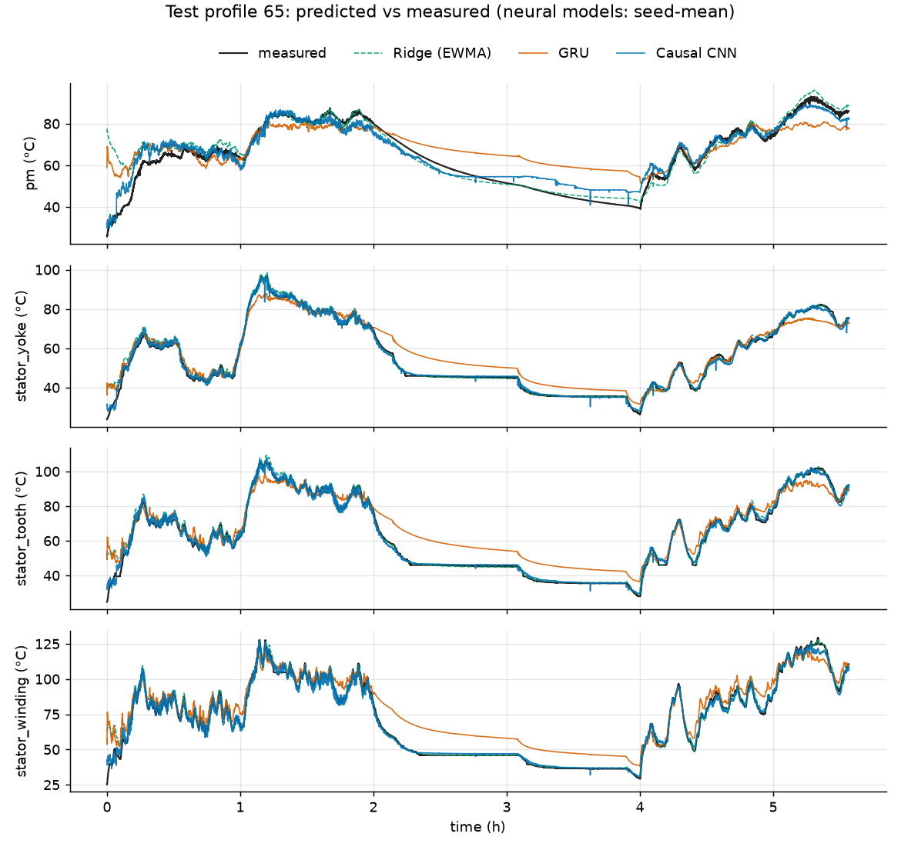
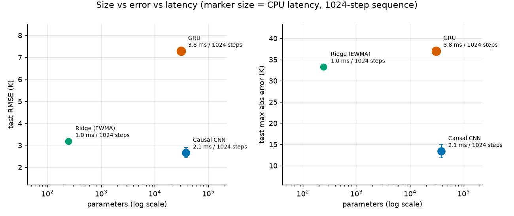

# Motor Thermal CNN


**Estimating the internal temperatures of a synchronous motor from the signals the drive already measures, with a small causal 1D CNN, judged on RMSE and on the worst-case error.**

A permanent magnet synchronous motor (PMSM) in an electric vehicle cannot carry a sensor on its rotor magnet, yet the magnet must not overheat. The controller needs a software estimate of the temperatures of the magnet, stator yoke, stator tooth and stator winding, built from voltages, currents, speed, torque and coolant and ambient temperature. This project builds that estimator and measures how wrong it can be.

| | |
|---|---|
| Data | Paderborn University "Electric Motor Temperature" test-bench recordings (69 profiles, 1.33 M samples at 2 Hz) |
| Model | Causal dilated residual 1D CNN, 38,052 parameters, 34-minute receptive field, 188 KiB as ONNX |
| Test result | **2.66 ± 0.23 K RMSE** and **13.4 ± 1.6 K maximum error**, mean over the 4 targets and 3 seeds, on two unseen profiles |
| Baseline | Ridge regression with moving-average features: 3.19 K RMSE, **33.3 K** maximum error |
| Inference | 2.1 ms (median) for a 1024-step sequence on one CPU thread with ONNX Runtime |



## Contents

- [Results](#results) · [Protocol](#protocol) · [Models](#models) · [Safety margin](#safety-margin) · [Uncertainty](#uncertainty) · [Why the split is by profile](#why-the-split-is-by-profile) · [Limitations](#limitations)
- [Run it](#run-it) · [Demo app](#demo-app) · [Repository layout](#repository-layout) · [References](#references)

## Results

Test profiles 65 and 72, pooled. Errors in kelvin (a difference in K equals a difference in °C). Neural models: mean ± sample standard deviation over seeds.

| Model | Parameters | Seeds | Test RMSE (K) | Test max error (K) | Validation RMSE (K) |
|---|---:|---:|---:|---:|---:|
| Ridge (EWMA features) | 244 | 1 | 3.19 | 33.25 | 2.05 |
| GRU (budget-limited, see below) | 30,916 | 1 | 7.29 | 37.04 | 7.66 |
| **Causal CNN** | 38,052 | 3 | **2.66 ± 0.23** | **13.40 ± 1.60** | 2.00 ± 0.06 |

Per target, CNN (RMSE / max error, K): magnet 4.33 / 13.76, stator yoke 1.61 / 11.64, stator tooth 2.02 / 10.69, stator winding 2.69 / 17.50. The magnet is the hardest target, with the largest RMSE.

Per test profile the picture is less one-sided. The CNN is better than ridge on profile 65 (RMSE 2.49 vs 3.56 K, max 13.2 vs 33.3 K) but **worse on profile 72** (3.02 vs 1.86 K RMSE, 11.6 vs 4.8 K max). With only two test profiles, the averages are dominated by a few events.

Full tables (per target, per profile, size and latency, hyperparameter search) are in [`results/metrics.md`](results/metrics.md); raw numbers in [`results/metrics.json`](results/metrics.json).



## Protocol

The evaluation rules are fixed in [`docs/design.md`](docs/design.md):

1. **Inputs only.** The model sees `u_q, u_d, i_d, i_q, motor_speed, torque, coolant, ambient`. No target temperature, and no function of one, is ever an input.
2. **Causal.** The estimate at time *t* uses inputs up to *t* only. A unit test perturbs the future and checks that past outputs do not change.
3. **Split by measurement profile.** Train: 66 profiles. Validation: profile 58. Test: profiles 65 and 72. Scalers are fitted on training profiles only. Hyperparameters were selected on profile 58; each final model was evaluated on the test profiles once.
4. **Metrics.** RMSE and maximum absolute error, per target and averaged over the four targets.

This split was chosen for this project; at least one published paper on this dataset also tests on profiles 65 and 72. Numbers from papers are only comparable when the test profiles, the targets and the input set match, so none are copied into this README. See [References](#references).

## Models

- **Causal CNN (main model).** 12 residual blocks of dilated causal convolutions (kernel 2, 32 channels, dilations doubling up to a receptive field of 4096 samples, about 34 minutes at 2 Hz), dropout 0.1, 4 outputs. A long receptive field matters: thermal time constants are minutes, and a first search with a shorter field (about 8.5 minutes) reached 4.9 K validation RMSE in the search, against 2.2 K for the long field.
- **Ridge baseline.** Current inputs plus exponentially weighted moving averages over five time spans. 244 parameters. It is hard to beat on profile 72 and it shows how much of the problem is linear.
- **GRU.** One layer, 96 hidden units. It failed with short training chunks, was retrained with longer ones, and still tracks the thermal decay poorly (visible in the figure above). **It is under-tuned and has one seed, so it is not evidence that CNNs beat recurrent networks.** Treat it as a floor, not a competitor.

## Safety margin

For derating, the dangerous direction is under-estimating a temperature. [`results/metrics.md`](results/metrics.md) gives, per profile and target, the error quantiles (median, 90th, 99th, 99.9th percentile of the absolute error), the worst signed error, and the worst under-estimate for the CNN seed ensemble. Pooled over the test profiles, the worst single-sample errors are:

| Target | Max abs error (K) | Worst error direction | Worst under-estimate (K) |
|---|---:|---|---:|
| Magnet | 12.3 | over-estimate | 11.8 |
| Stator yoke | 11.5 | under-estimate | 11.5 |
| Stator tooth | 9.5 | over-estimate | 8.6 |
| Stator winding | 17.3 | over-estimate | 12.1 |

A protection scheme built on this estimator would need to add a margin of the order of the worst-case error, not of the RMSE. The [demo app](#demo-app) has a slider that shows how many samples a given margin would still miss.

## Uncertainty

Two simple approaches were tried and **both are under-covering**, which is reported rather than hidden:

| Method | Nominal coverage | Empirical coverage on test | Mean width (K) |
|---|---:|---:|---:|
| Split-conformal intervals on the 3-seed ensemble | 90% | 78.2% | 5.63 |
| Split-conformal intervals on the 3-seed ensemble | 95% | 84.1% | 6.69 |
| Ensemble spread ± 1.645 std | 90% | 49.9% | 3.54 |

The conformal calibration uses one validation profile whose points are strongly correlated in time, so the usual exchangeability guarantee does not apply. The seed-to-seed spread of three models is far too small to describe real error. A better approach would calibrate across several profiles.

## Why the split is by profile

Samples inside one recording are strongly correlated, so splitting random windows between train and test lets the model see its neighbours. A short comparison (same CNN configuration, one seed, trained once) shows the effect:

| Evaluation | RMSE (K) | Max error (K) |
|---|---:|---:|
| Random-window split (held-out windows of seen profiles) | 3.67 | 20.58 |
| Profile split, windows of the test profiles | 4.75 | 22.50 |
| Profile split, full test profiles | 4.45 | 19.68 |

The random split looks better, as expected, but the gap is moderate on this short run and comes from a single seed, so read it as an illustration and not as a measurement of how large the leakage can get.

## Limitations

- Two test profiles only. Rankings can flip from one profile to the other (ridge beats the CNN on profile 72).
- The maximum error is the single worst sample per target; it is noisy by nature.
- GRU: one seed, one configuration, under-tuned.
- The exported ONNX model is stateless: a streaming step has to re-feed the 4096-sample window (8.6 ms median on one CPU thread). A stateful or ring-buffer implementation would be needed for an embedded controller, and no quantization or microcontroller deployment was done.
- Uncertainty intervals under-cover (see above).
- No physics-based baseline (lumped-parameter thermal network) and no comparison with other published architectures on identical conditions.
- One motor, one test bench. Nothing here says the estimator transfers to another machine.

## Run it

The raw dataset is not redistributed (its licence has not been verified here). Download it from Kaggle: [wkirgsn/electric-motor-temperature](https://www.kaggle.com/datasets/wkirgsn/electric-motor-temperature), which needs a free Kaggle account.

```bash
git clone https://github.com/yvsn11/motor-thermal-cnn.git
cd motor-thermal-cnn
python -m venv .venv && source .venv/bin/activate     # Windows: .venv\Scripts\activate
pip install -e ".[dev,app]"
python scripts/download_data.py        # uses kagglehub; or put measures_v2.csv in data/
bash scripts/run_all.sh                # full pipeline: about 45-60 min on 2 CPU cores
```

Everything is also available as `make` targets (`make help`). The pre-trained CNN (`models/cnn1d.onnx`) is included, so the demo and the tests run without retraining. Tests use synthetic data only:

```bash
pytest && ruff check . && ruff format --check .
```

## Demo app

```bash
streamlit run app/streamlit_app.py     # or: make app
```

Pick a profile from the dataset file (or upload a CSV with the dataset columns) and see measured against predicted curves for the four targets, the error plots, RMSE and maximum error per target, and a derating-margin slider. The app needs the data file locally, since the data is not shipped with the repository.

## Repository layout

```
src/motor_thermal/   data.py  models.py  train.py  evaluate.py  export.py  uncertainty.py  predict.py
tests/               unit tests on synthetic data (causality, no profile mixing, no target leakage)
configs/             run configurations
scripts/             download_data.py, run_all.sh
app/                 Streamlit demo
models/              cnn1d.pt, cnn1d.onnx, scaler.json (runs/ holds the per-seed checkpoints)
results/             metrics.md, metrics.json, figures/, logs/
docs/design.md       specification and evaluation rules
.github/workflows/   CI: ruff and pytest on Python 3.11 and 3.12
```

## References

- W. Kirchgässner, O. Wallscheid, J. Böcker, "Estimating Electric Motor Temperatures with Deep Residual Machine Learning", *IEEE Transactions on Power Electronics* 36(7), 2021, [doi:10.1109/tpel.2020.3045596](https://doi.org/10.1109/tpel.2020.3045596). The dataset paper.
- W. Kirchgässner, O. Wallscheid, J. Böcker, "Data-Driven Permanent Magnet Temperature Estimation in Synchronous Motors with Supervised Machine Learning: A Benchmark", [arXiv:2001.06246](https://arxiv.org/abs/2001.06246).
- W. Kirchgässner, O. Wallscheid, J. Böcker, "Thermal Neural Networks: Lumped-Parameter Thermal Modeling With State-Space Machine Learning", [arXiv:2103.16323](https://arxiv.org/abs/2103.16323). A physics-inspired model that is far smaller than this CNN.

## License

[MIT](LICENSE). The dataset is not part of this repository and remains under its own terms.
